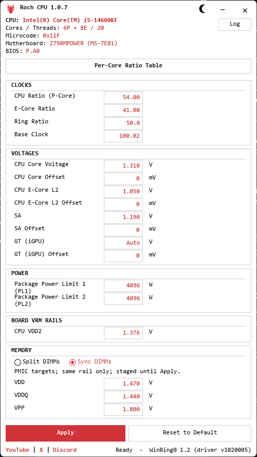
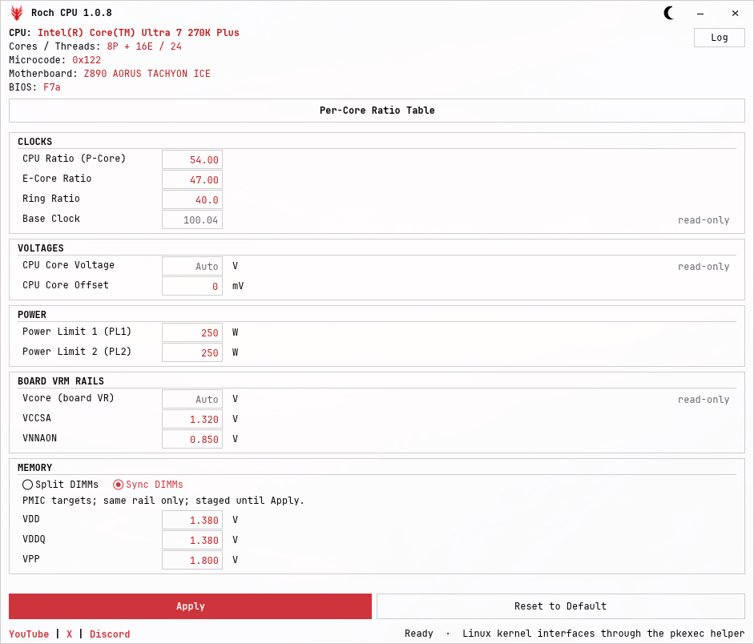

# Roch CPU

CPU and DDR5 memory tuning for Intel LGA1700 (12th–14th Gen), Intel LGA1851 (Core Ultra 200S and 200S Plus) and AMD Ryzen, on Windows and Linux: ratios, voltages, power limits and Curve Optimizer in one compact light/dark window. Available controls depend on your hardware and BIOS.

## Install

1. Download the zip from [Releases](https://github.com/1xroch/Roch-CPU/releases).
2. Extract the whole folder; keep the driver and `pawnio` folder beside `Roch CPU.exe`.
3. Run `Roch CPU.exe` as administrator. Windows 10/11 x64; no runtime needed.

If Windows blocks the driver (Memory Integrity or the vulnerable-driver blocklist), tuning controls are unavailable.

### Linux

1. Download `Roch-CPU-<version>-linux-x86_64.tar.gz` from [Releases](https://github.com/1xroch/Roch-CPU/releases), extract it and run its `install.sh`; or build it (below) and run `packaging/linux/install.sh`. Either puts `rochcpu` in `~/.local/bin` and adds **Roch CPU** to your launcher.
2. Run it as your normal user. The window stays an ordinary Wayland or X11 app; a small helper (the same program, started through `pkexec`) does the register access as root and asks for your password at each launch.
3. `sudo rochcpu --probe` runs the diagnostics directly.

Needs polkit, and kernel lockdown off (it is usually tied to Secure Boot): lockdown refuses MSR and port access to every program. See [Linux notes](docs/linux.md).

## What's new in 1.0.8

- **Linux:** the same window and rows on Wayland and X11, through the kernel's own interfaces (`/dev/cpu/*/msr`, sysfs, `i2c-dev`) and a `pkexec` helper. No driver to install.
- **Arrow Lake (Core Ultra 200S / 200S Plus, LGA1851):** ratios, per-core and per-cluster ratios, ring, PL1/PL2, core voltage offset and DDR5 rails, every one write-tested on a 270K Plus.
- **Board regulators (Z890 AORUS TACHYON ICE, Linux):** VCCSA (NGU, memory controller) and VNNAON (D2D) set through the board's own PMBus regulators, with the regulator's output checked after each write.
- **`--write-test`:** writes every Intel row a small step, measures the effect, then restores every register exactly and proves it.
- **Fixed:** the PCH SMBus is found on 800-series boards (bus 0x80); IccMax above 255 A read wrong; "F" Core Ultra parts kept GT rows; the OC mailbox's status codes are Intel's; a busy CPU no longer fails "0 = restore".
- **Clearer rows:** Power Limit 1/2 fit on one line.

## Features

- **Intel:** P-core, E-core and ring ratios, per-core and per-E-core-cluster ratios, Core/E-core L2/SA/GT voltage and offset, PL1/PL2.
- **Arrow Lake (LGA1851):** the same ratios, per-core ratios, ring and power limits, plus the core voltage offset (with the BIOS's Undervolt Protection off). Arrow Lake has no E-core L2 rail and its iGPU is not on the OC mailbox, so those rows are not shown; a fixed core voltage is BIOS-only. D2D and NGU clocks are set at boot only, in the BIOS.
- **Board regulators:** on the Z890 AORUS TACHYON ICE (Linux), VCCSA and VNNAON through the board's PMBus regulators. Vcore stays the CPU's.
- **MSI boards:** CPU Core override through the board regulator, base clock and CPU VDD2, each measured after every step (Z690/Z790; not yet mapped on Z890).
- **AMD Ryzen:** PPT, TDC, EDC, thermal limit, PBO scalar, FMax and Curve Optimizer (all-core and per-core) through the SMU. Optional [PawnIO](https://pawnio.eu) reads back the limits in force.
- **DDR5:** per-DIMM or synced VDD, VDDQ and VPP, calibrated against each PMIC's own ADC and verified after every write.
- **Safety:** every write is read back, failed writes roll back, and **0** restores the value found at start-up. The Log explains anything rejected or unavailable.

A setting the BIOS locks or caps (for example the P-core ratio) cannot be raised from the operating system.

## Screenshots

<p align="center">
  
  
  
</p>

Left: 1.0.7 on an i5-14600KF / Z790MPOWER (Windows). Middle: 1.0.8 on a Core Ultra 7 270K Plus / Z890 AORUS TACHYON ICE (Linux, Hyprland). Right: 1.0.5 on a Ryzen 7 9850X3D / X870 AORUS TACHYON ICE. Values are examples, not tuning advice.

## Build from source

Install the stable Rust toolchain for `x86_64-pc-windows-msvc` ([rustup](https://rustup.rs) with the Visual Studio C++ build tools), then:

```bat
build.cmd
cargo test --release
```

`build.cmd` writes `dist\Roch CPU.exe` with its driver files; the tests use simulated hardware only.

On Linux, with stable Rust and polkit installed:

```sh
cargo build --release --locked
cargo test --release
packaging/linux/install.sh     # or run ./target/release/roch-cpu directly
```

`Roch CPU.exe --help` (`rochcpu --help` on Linux) lists the diagnostic switches: `--probe` writes a read-only hardware report, `--mailbox-scan` dumps the OC mailbox for a CPU this has not seen, `--write-test` checks every row on the real machine, and `--ui-preview` opens the window with sample data.

> Overclocking can cause crashes, data loss or hardware damage. Change one setting at a time and test stability; read-back does not prove a setting is stable.

## More

[Hardware reference and verification notes](docs/reference.md) · [Linux notes](docs/linux.md) · [ASUS validation](docs/asus-z790-validation.md) · [BCLK investigation](docs/b850mpower-bclk-investigation.md) · [Third-party notices](THIRD-PARTY-NOTICES.md) · [License](LICENSE)

## Credits

Ivan Rusanov's [ZenStates-Core](https://github.com/irusanov/ZenStates-Core) (AMD SMU reference), [OpenLibSys](THIRD-PARTY-NOTICES.md#winring0-driverswinring0x64sys) (WinRing0 driver), [LibreHardwareMonitor](https://github.com/LibreHardwareMonitor/LibreHardwareMonitor) (Super I/O reference), namazso's [PawnIO](https://pawnio.eu) and [PawnIO.Modules](https://github.com/namazso/PawnIO.Modules), and [ryzen_smu](https://gitlab.com/leogx9r/ryzen_smu).

Created by **Roch Studio / [@1xroch](https://x.com/1xroch)** · [YouTube](https://www.youtube.com/@MateoPcTech) | [X](https://x.com/1xroch) | [Discord](https://discord.gg/KfzExpKQHB)
